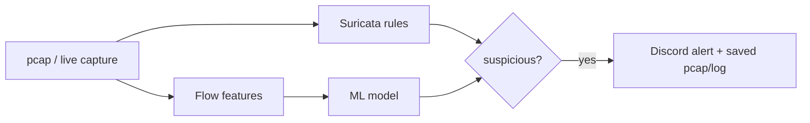

# Heimdall Lite

A free, laptop-only network detection lab that **compares rule-based (Suricata) and ML-based detection** on malware traffic, and reports honestly where each one wins and fails.

> Status: core pipeline complete — rules, ML, Discord alerting (both replay and live demo modes), 3 incident reports.

## Goal
Reproducible, offline, $0 pcap analysis pipeline: replay (or live-capture) traffic, detect with Suricata rules and an ML model, compare the results, and alert on Discord.

## Pipeline


## Detection targets and how each is covered
| Target | Data | Detection |
|---|---|---|
| Botnet C2 beaconing | CTU-13 + malware-traffic-analysis.net pcaps | Suricata rules vs Random Forest on flow features |
| Port scanning | Own lab traffic (Windows host -> sensor VM) | Custom Suricata rule |
| SSH brute force | Own lab traffic (Windows host -> sensor VM) | Custom Suricata rule |
| Host/network sweeps (ICMP, SMB) | malware-traffic-analysis.net pcap | Behavioural (fan-out) feature; rules largely miss this |
| DGA domains | Domain lists | Stretch goal, not done |

## Stack
Ubuntu Server 24.04 (VirtualBox), Suricata 8, Wireshark (manual cross-check), Python (pandas, scikit-learn), Discord webhook, jq.

## Repo structure
| Folder | Purpose |
|---|---|
| `rules/` | Custom Suricata rules (`heimdall.rules`) and rule-group config (`enable.conf`) |
| `scripts/` | `replay_pcap.sh` (offline Suricata run), `alert_discord.py` + `run_pipeline.sh` (replay-mode alerting), `live_watch.py` (live-mode alerting), `rules_recall.sh` |
| `ml/` | Feature prep, training/evaluation, sanity checks |
| `reports/` | Incident reports, evaluation, demo script, images |
| `pcaps/`, `data/`, `out/`, `evidence/` | Local-only working data (gitignored) |

## Reproduce an analysis
```bash
scripts/replay_pcap.sh pcaps/<file>.pcap
```
Runs Suricata offline on the pcap and prints the alert count and the top rules. Output goes to `out/` (gitignored).

## Alerting (replay mode)
`scripts/run_pipeline.sh <pcap>` replays a capture through Suricata and posts one summary to Discord when it finds severity 1-2 rule hits or a host contacting 26+ destinations in a minute. Evidence pcaps are saved locally and attached when small.


## Demo flow (live mode)
Three terminals, run in this order:

1. **Suricata (live capture)** — VM, terminal 1:
   ```bash
   cd ~/heimdall-lite
   mkdir -p out/live
   sudo rm -f out/live/eve.json out/live/fast.log
   sudo suricata -c /etc/suricata/suricata.yaml -s rules/heimdall.rules -i enp0s8 -l out/live -k none
   ```
   Wait for `Engine started`, then wait **1-2 more minutes** before generating traffic — rule loading takes time, and anything sent too early is missed.

2. **Discord watcher** — VM, terminal 2 (new SSH session):
   ```bash
   cd ~/heimdall-lite
   sudo chmod 644 out/live/eve.json
   source ~/venv-heimdall/bin/activate
   python scripts/live_watch.py out/live/eve.json
   ```
   Prints `Watching out/live/eve.json ...` and then one line per alert it forwards.

3. **Generate traffic** — Windows PowerShell:
   ```powershell
   nmap -sS -T4 -p 1-1024 192.168.56.111
   ```
   Within a few seconds, terminal 2 prints `RULE ALERT ...` and a message appears in Discord.

Stop with Ctrl+C in terminal 2, then terminal 1.

**Note:** live mode detects and alerts from Suricata's `eve.json` stream; it does not attach evidence pcaps (no file exists yet to cut a slice from). Evidence pcaps are a replay-mode feature only (`scripts/run_pipeline.sh`, above).

## Progress
- [x] Sensor VM (Ubuntu Server 24.04) and Suricata with ET Open rules
- [x] Replay script
- [x] Incident report 01: Cobalt Strike beaconing + SMB/ICMP sweeps, cross-checked in Wireshark
- [x] Incident reports 02-03 (port scan, SSH brute force)
- [x] Custom Suricata rules (SYN scan, SSH brute force)
- [x] ML detector + rules-vs-ML evaluation
- [x] Discord alerts (replay mode and live mode)
- [ ] Demo video

## Scope and limits
- Lab / own-network use only. Detection is alert-only (no blocking), no 24/7 daemon.
- CTU-13 is old (2011-era botnets) and weak on modern encrypted traffic. Its full-traffic pcaps are not public (privacy); the botnet-only pcaps are, plus labelled flows. Results are reported with this in mind.
- ML/behavioural thresholds are tuned on lab/CTU-13 data and will produce false positives on real networks.
- Live mode has no attached pcap evidence; replay mode does.
