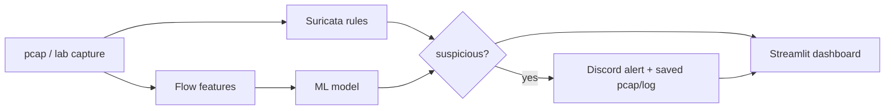
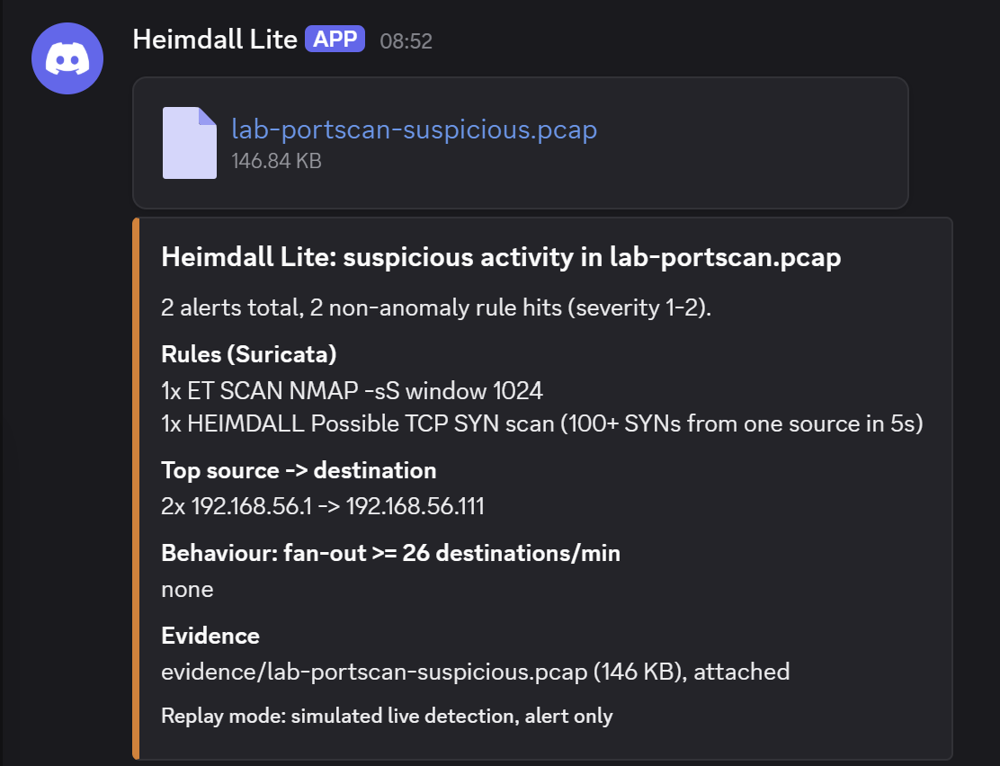

# Heimdall Lite

A free, laptop-only network detection lab that **compares rule-based (Suricata) and ML-based detection** on malware traffic, and reports honestly where each one wins and fails.

> Status: work in progress. Rules side working (incident reports, replay script); ML evaluation, alerting and dashboard in progress.

## Goal
Reproducible, offline, $0 pcap analysis pipeline: replay traffic, detect with Suricata rules and an ML model, compare the results, alert on Discord, and show everything in a small dashboard.

## Pipeline


## Detection targets and how each is covered
| Target | Data | Detection |
|---|---|---|
| Botnet C2 beaconing | CTU-13 + malware-traffic-analysis.net pcaps | Suricata rules vs Random Forest on flow features |
| Port scanning | Own lab traffic (Kali VM -> sensor VM) | Suricata rules |
| SSH brute force | Own lab traffic (Kali VM -> sensor VM) | Suricata rules |
| DGA domains | Domain lists | Stretch goal |

## Stack
Ubuntu Server 24.04 (VirtualBox), Suricata 8, Wireshark (manual cross-check), Python (pandas, scikit-learn), Streamlit, Discord webhook, jq.

## Repo structure
| Folder | Purpose |
|---|---|
| `rules/` | Custom Suricata rules |
| `scripts/` | Helper scripts (e.g. `replay_pcap.sh`) |
| `reports/` | Incident reports and evaluation |
| `pcaps/` | Local pcaps (gitignored, not published) |

## Reproduce an analysis
```bash
scripts/replay_pcap.sh pcaps/<file>.pcap
```
Runs Suricata offline on the pcap and prints the alert count and the top rules. Output goes to `out/` (gitignored).

## Progress
- [x] Sensor VM (Ubuntu Server 24.04) and Suricata with ET Open rules
- [x] Replay script
- [x] Incident report 01: Cobalt Strike beaconing, cross-checked in Wireshark
- [ ] Incident reports 02-03 (port scan, SSH brute force)
- [ ] Custom Suricata rules
- [ ] ML detector + rules-vs-ML evaluation
- [ ] Discord alerts (replay mode) + dashboard
- [ ] Demo video

## Scope and limits
- Lab / own-network use only. Detection is alert-only (no blocking).
- "Live" behaviour is simulated by replaying pcaps; there is no 24/7 sensor.
- CTU-13 is old (2011-era botnets) and weak on modern encrypted traffic. Its full-traffic pcaps are not public (privacy); the botnet-only pcaps are, plus labelled flows. Results are reported with this in mind.
- ML on labelled lab/CTU-13 data will produce false positives on real networks.

## Alerting (replay mode)
`scripts/run_pipeline.sh <pcap>` replays a capture through Suricata and posts one summary to Discord when it finds severity 1-2 rule hits or a host contacting 26+ destinations in a minute. Evidence pcaps are saved locally and attached when small.


