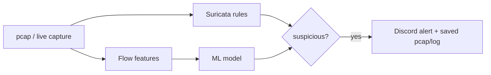

# Heimdall Lite

A free, laptop-based network detection lab that compares rule-based detection using Suricata with ML-based detection on malware traffic. It evaluates the strengths and limitations of both approaches using reproducible experiments.

> **Status:** Core pipeline complete. Includes custom detection rules, ML detection, Discord alerting for replay and live demo modes, and three incident reports.

## Goal

Build a reproducible, offline, zero-cost PCAP analysis pipeline that can replay or capture network traffic, detect suspicious activity using Suricata and an ML model, compare detection results, and send alerts to Discord.

## Pipeline



## Detection Targets and Coverage

| Target | Data | Detection |
|---|---|---|
| Botnet C2 beaconing | CTU-13 and malware-traffic-analysis.net pcaps | Suricata rules vs Random Forest on flow features |
| Port scanning | Own lab traffic (Windows host → sensor VM) | Custom Suricata rule |
| SSH brute force | Own lab traffic (Windows host → sensor VM) | Custom Suricata rule |
| Host/network sweeps (ICMP, SMB) | malware-traffic-analysis.net pcap | Behavioural fan-out feature. Suricata rules largely miss this activity |
| DGA domains | Domain lists | Stretch goal. Not implemented |

## Stack

Ubuntu Server 24.04 (VirtualBox), Suricata 8, Wireshark for manual cross-checking, Python (pandas, scikit-learn), Discord webhook, and jq.

## Repository Structure

| Folder | Purpose |
|---|---|
| `rules/` | Custom Suricata rules (`heimdall.rules`) and rule group configuration (`enable.conf`) |
| `scripts/` | `replay_pcap.sh` for offline Suricata analysis, `alert_discord.py` and `run_pipeline.sh` for replay-mode alerting, `live_watch.py` for live-mode alerting, and `rules_recall.sh` |
| `ml/` | Feature preparation, model training and evaluation, and sanity checks |
| `reports/` | Incident reports, evaluation results, demo script, and images |
| `pcaps/`, `data/`, `out/`, `evidence/` | Local working data. Excluded from Git |

## Reproducing an Analysis

```bash
scripts/replay_pcap.sh pcaps/<file>.pcap
```

Runs Suricata against the specified PCAP in offline mode. The script prints the total alert count and the most frequently triggered rules. All output is stored in `out/`, which is excluded from Git.

## Alerting (Replay Mode)

```bash
scripts/run_pipeline.sh <pcap>
```

Replays the specified capture through Suricata and sends a summary to Discord when it detects severity 1–2 rule hits or a host contacting 26 or more destinations within one minute.

Evidence PCAPs are saved locally and attached to Discord alerts when the file size permits.


## Demo Flow (Live Mode)

The live demo uses three terminals. Run them in the following order.

### 1. Suricata Live Capture

**Environment:** Sensor VM, Terminal 1

```bash
cd ~/heimdall-lite
mkdir -p out/live
sudo rm -f out/live/eve.json out/live/fast.log
sudo suricata -c /etc/suricata/suricata.yaml -s rules/heimdall.rules -i enp0s8 -l out/live -k none
```

Wait until `Engine started` appears. Then allow another **1–2 minutes** before generating traffic. This gives Suricata time to load the rules and prevents early traffic from being missed.

### 2. Discord Watcher

**Environment:** Sensor VM, Terminal 2 (new SSH session)

```bash
cd ~/heimdall-lite
sudo chmod 644 out/live/eve.json
source ~/venv-heimdall/bin/activate
python scripts/live_watch.py out/live/eve.json
```

The watcher should print:

```text
Watching out/live/eve.json ...
```

It then prints one line for each alert forwarded to Discord.

### 3. Generate Traffic

**Environment:** Windows PowerShell

```powershell
nmap -sS -T4 -p 1-1024 192.168.56.111
```

Within a few seconds, Terminal 2 should display a `RULE ALERT ...` message, followed by a Discord notification.

### Stopping the Demo

Press `Ctrl+C` in Terminal 2 first, followed by Terminal 1.

**Note:** Live mode detects and forwards alerts directly from Suricata's `eve.json` stream. It does not attach evidence PCAPs because there is no completed capture file to extract traffic from. Evidence PCAP generation is only available in replay mode through `scripts/run_pipeline.sh`.

## Scope and Limitations

- Designed for lab environments and networks under the user's control. Detection is alert-only, with no traffic blocking or continuous 24/7 monitoring.
- CTU-13 contains botnet traffic from 2011 and has limited coverage of modern encrypted traffic. Full-traffic PCAPs are not publicly available due to privacy restrictions. Publicly available botnet-only PCAPs and labelled flow data are used instead. Evaluation results are presented with these limitations in mind.
- ML and behavioural detection thresholds are tuned using lab and CTU-13 data. They may generate false positives when applied to real-world networks.
- Live mode does not provide attached PCAP evidence. Evidence capture and attachment are supported in replay mode only.
