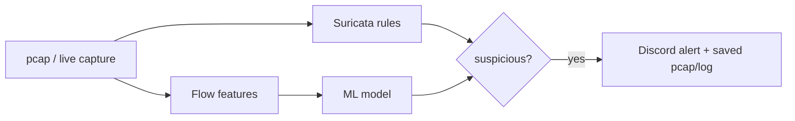

# Heimdall Lite

A free, laptop-only network detection lab that compares rule-based detection (Suricata) and ML-based detection on malware traffic, and reports honestly where each one succeeds and where each one fails.

## Goal

A reproducible, offline, zero-cost pipeline: replay or live-capture traffic, detect with Suricata rules and a machine learning model, compare the results, and send alerts to Discord.

## Pipeline



## Detection targets and how each is covered

| Target | Data | Detection |
|---|---|---|
| Botnet C2 beaconing | CTU-13 and malware-traffic-analysis.net pcaps | Suricata rules compared against a Random Forest model on flow features |
| Port scanning | Traffic generated in the lab (Windows host to sensor VM) | Custom Suricata rule |
| SSH brute force | Traffic generated in the lab (Windows host to sensor VM) | Custom Suricata rule |
| Host and network sweeps (ICMP, SMB) | malware-traffic-analysis.net pcap | Behavioural fan-out feature, since rules largely miss this pattern |

## Stack

Ubuntu Server 24.04 on VirtualBox, Suricata 8, Wireshark for manual cross-checking, Python with pandas and scikit-learn, a Discord webhook, and jq.

## Repo structure

| Folder | Purpose |
|---|---|
| `rules/` | Custom Suricata rules (`heimdall.rules`) and the rule-group configuration (`enable.conf`) |
| `scripts/` | `replay_pcap.sh` for offline Suricata runs, `alert_discord.py` and `run_pipeline.sh` for replay mode alerting, `live_watch.py` for live mode alerting, and `rules_recall.sh` |
| `ml/` | Feature preparation, training and evaluation, and sanity checks |
| `reports/` | Incident reports, the evaluation report, the demo script, and images |
| `pcaps/`, `data/`, `out/`, `evidence/` | Local working data, excluded from version control |

## Reproduce an analysis

```bash
scripts/replay_pcap.sh pcaps/<file>.pcap
```

This runs Suricata offline against the pcap and prints the alert count along with the top matching rules. Output is written to `out/`, which is excluded from version control.

## Alerting in replay mode

`scripts/run_pipeline.sh <pcap>` replays a capture through Suricata and posts a single summary to Discord when it finds severity 1 or 2 rule hits, or a host contacting 26 or more destinations within a minute. Evidence pcaps are saved locally and attached to the Discord message when small enough.


## Demo flow in live mode

Three terminals, run in this order.

**Terminal 1, on the VM: start Suricata in live capture mode.**

```bash
cd ~/heimdall-lite
mkdir -p out/live
sudo rm -f out/live/eve.json out/live/fast.log
sudo suricata -c /etc/suricata/suricata.yaml -s rules/heimdall.rules -i enp0s8 -l out/live -k none
```

Wait for the "Engine started" message, then wait one to two more minutes before generating traffic. Rule loading takes time, and traffic sent too early will be missed.

**Terminal 2, on the VM, a new SSH session: start the Discord watcher.**

```bash
cd ~/heimdall-lite
sudo chmod 644 out/live/eve.json
source ~/venv-heimdall/bin/activate
python scripts/live_watch.py out/live/eve.json
```

This prints "Watching out/live/eve.json" and then one line for each alert it forwards.

**Terminal 3, on Windows: generate traffic.**

```powershell
nmap -sS -T4 -p 1-1024 192.168.56.111
```

Within a few seconds, terminal 2 prints a rule alert and a message appears in Discord.

Stop the session with Ctrl+C in terminal 2, then in terminal 1.

Live mode detects and alerts directly from Suricata's `eve.json` stream, so it does not attach evidence pcaps, since no capture file exists yet to cut a slice from. Evidence pcaps are available in replay mode only, through `scripts/run_pipeline.sh` above.

## Scope and limits

This project is intended for lab and personal network use only. Detection is alert-only, with no blocking and no continuously running daemon.

CTU-13 is a 2011-era dataset and is weak on modern encrypted traffic. Its full-traffic pcaps are not public for privacy reasons, though the botnet-only pcaps and labelled flow data are. Results throughout this project are reported with that limitation in mind.

The ML model and behavioural thresholds are tuned on lab and CTU-13 data and will produce false positives on real networks.

Live mode does not attach pcap evidence to its alerts. Replay mode does.
