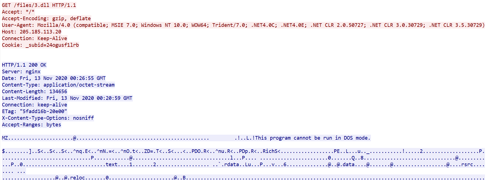
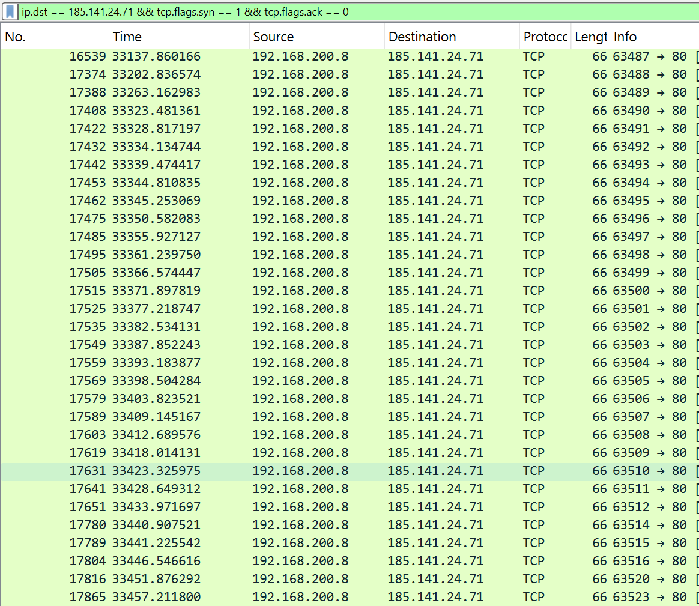

# Incident 01: Cobalt Strike beaconing (2020-11-13 exercise)

**Source:** malware-traffic-analysis.net training exercise (2020-11-13), replayed offline.
**Tooling:** Suricata 8.0.8 + Emerging Threats Open ruleset, `jq` for log analysis.
**Reproduce:** `scripts/replay_pcap.sh pcaps/2020-11-13-traffic-analysis-exercise.pcap`

## Summary
The capture (22,199 packets, ~10.7 hours, 00:26 to 11:08 UTC) shows one internal host, `192.168.200.8`, downloading an executable payload, repeatedly resolving two suspicious `.pw` domains, and later beaconing to an external server at regular intervals. Suricata raised 349 alerts, but most come from a few repeating rules.

## Alert overview
| Count | Rule | Note |
|---|---|---|
| 132 | ET INFO OpenSSL Demo CA - Internet Widgits Pty (O) | Default/placeholder TLS certificate; informational only (priority 3) |
| 127 | ET DNS Query to a *.pw domain - Likely Hostile | Two domains, see IOCs |
| 77 | ET MALWARE Cobalt Strike Beacon Observed | HTTP, port 80 |
| 2 | ET INFO PE EXE or DLL Windows file download HTTP | Payload delivery |
| other | Likely Evil EXE download (MSXMLHTTP), Dotted Quad DLL request, NTLM | See timeline |

349 alerts do not mean 349 attacks: one infection produces many repeated alerts.

## Timeline (UTC, from fast.log / eve.json)
| Time | Event |
|---|---|
| 00:26:49 | Start of capture |
| 00:26:54-55 | `192.168.200.8` requests a DLL from a bare IP (`205.185.113.20`) and receives an EXE/DLL (3+ MALWARE/INFO rules fire) |
| during capture | 127 DNS queries to two `.pw` domains, all answered with `198.211.99.24` |
| during capture | 131 TLS alerts for the "OpenSSL Demo CA" certificate from `198.211.99.24` |
| 09:39:07 | First flow to `185.141.24.71:80`: ~16 KB sent, ~765 KB received |
| 09:40-09:42 | Flows to `185.141.24.71` roughly every 60 s |
| from 09:42:18 | Flows roughly every 5.3 s, near-constant sizes (~683 B out / ~397 B in) |
| 11:08:33 | End of capture |

The 5.3 s cadence was observed in the first 20 flows reviewed (through 09:43:33); the full distribution has not been computed yet.

## Indicators of compromise (defanged)
| Type | Value | Role |
|---|---|---|
| Domain | `compactmuslimsdeport[.]pw` (125 queries) | Suspicious, resolves to 198[.]211[.]99[.]24 |
| Domain | `timerdisclaimer[.]pw` (2 queries) | Same IP |
| IP | `198[.]211[.]99[.]24` | Probable C2 over TLS (hypothesis) |
| IP | `185[.]141[.]24[.]71` | Cobalt Strike beacon traffic (rule-confirmed) |
| IP | `205[.]185[.]113[.]20` | Payload download |
| Host | `192.168.200.8` | Victim |

## What is confirmed vs. hypothesis
**Confirmed by logs:** payload download over HTTP; `.pw` domains resolve to `198.211.99.24`; the same IP presents the placeholder certificate; periodic HTTP flows to `185.141.24.71` that Suricata labels Cobalt Strike.

**Hypotheses (not proven):**
- `198.211.99.24` is a C2 server (traffic is encrypted, so content is not visible).
- The change from ~60 s to ~5 s intervals means an operator became active.
- Flows with different sizes (e.g. 1103/343 B) are tasking or data transfer.

## Open questions
- NTLM/SMB alerts to `198.211.99.171`: see "SMB sweep" below. What the sweep was for, and whether any session succeeded, is not determined.
- Compare findings with the exercise's published alerts and answers.

## Rules vs. ML (what this case suggests)
| Case | Rules (Suricata) | ML (planned) |
|---|---|---|
| Cobalt Strike over plain HTTP | Detected (77 alerts) | Timing/size regularity should also flag it |
| `.pw` domains | Detected via TLD rule | Random-looking names could also be caught by a DGA detector |
| Beaconing over TLS | Only a priority-3 certificate alert | Behaviour (interval, byte sizes) remains visible |

## Limitations
Single capture; no ground-truth labels, only rule output; rule hits depend on the ET Open ruleset version at replay time.

## Wireshark cross-check
Packet numbers in Wireshark match `pcap_cnt` in Suricata's `eve.json`, and relative times line up with Suricata's UTC timestamps.

**Payload delivery.** Following the HTTP stream of the alerted request shows `GET /files/3.dll` to `205.185.113.20`. The server answers `200 OK` (134,656 bytes) and the body starts with `MZ` / "This program cannot be run in DOS mode", so it is a Windows executable despite the `.dll` name. `Last-Modified` is about six minutes before the download.

**Beacon rhythm.** Filtering new connections (SYN) to `185.141.24.71` shows ~60 s gaps first, then ~5.3 s gaps, matching the flow analysis from `eve.json`. A few extra connections appear ~0.4 s after a regular one (possible tasking, unconfirmed).

## SMB sweep (added after further analysis)
Between 09:46:46 and 09:47:00 UTC (about 14 s), `192.168.200.8` opened 203 flows to TCP port 445 on 198 distinct addresses in `198.211.99.0/24`, mostly one connection per address. SMB to the internal server `192.168.200.2` (25 flows) is normal domain traffic and is excluded.

| Detector | Result |
|---|---|
| ET Open (scan ruleset enabled) | 1 alert: `ET SCAN Behavioral Unusual Port 445 traffic Potential Scan or Infection` |
| Custom rule `HEIMDALL` (100+ SYNs in 5 s towards `$HOME_NET`) | 0 alerts |

The custom rule is silent for two plausible reasons: the destinations are external rather than `$HOME_NET`, and the average rate (~14 new flows per second, ~70 per 5 s) is below its threshold (bursts were not checked).
Hypothesis: the host was scanning for SMB targets. Purpose and outcome are not determined; NTLM negotiation alerts exist for `198.211.99.171`.

**Relevance to ML:** a feature such as "distinct destination IPs per source per time window" (198 in ~14 s here) separates this behaviour clearly, while the per-packet rules barely register it.
