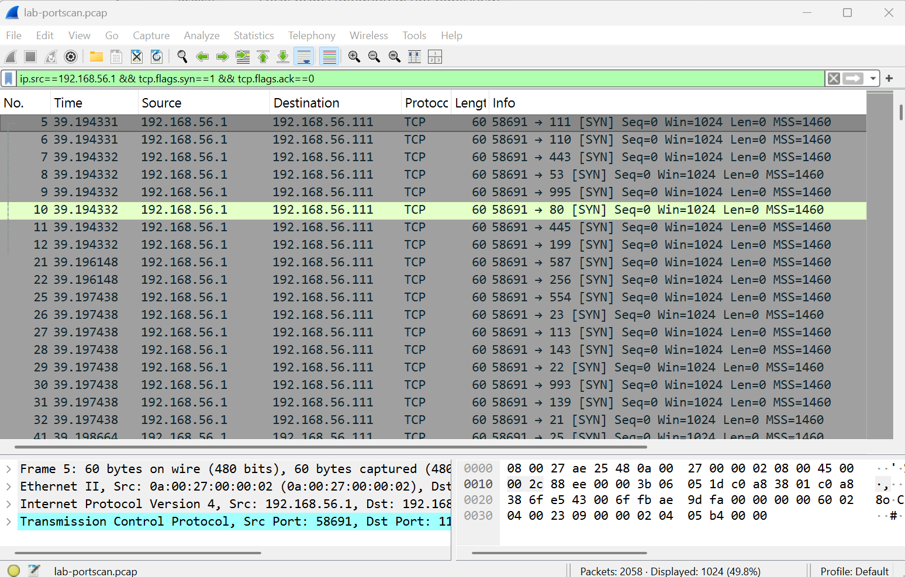
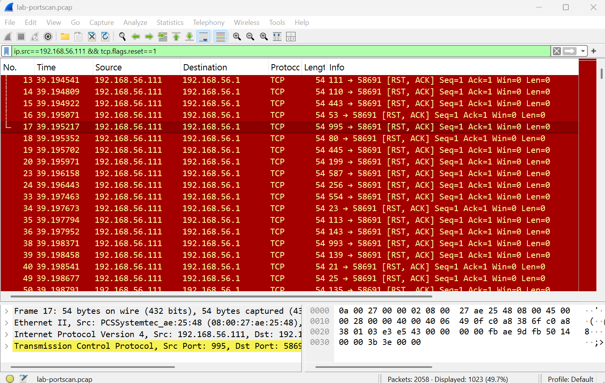
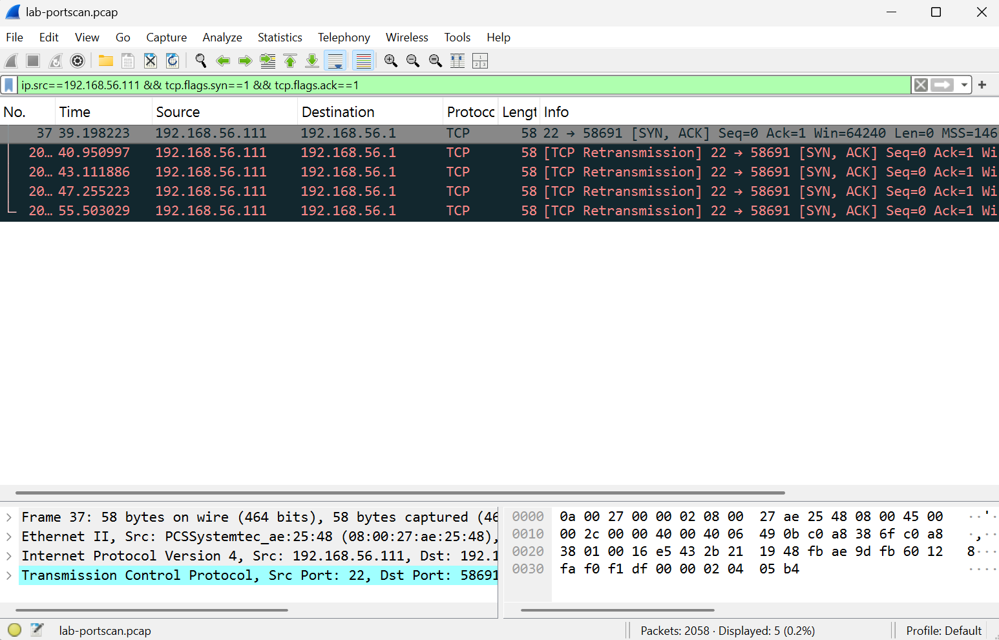

# Incident 02: TCP SYN port scan (own lab, known ground truth)

**Setup:** attacker = Windows host `192.168.56.1` (nmap), target = sensor VM `192.168.56.111` on the VirtualBox host-only network. Capture: `tcpdump -i enp0s8 host 192.168.56.1` on the target (`lab-portscan.pcap`, 2,058 packets, 117,414 bytes). Lab only, no other network was scanned.
**Ground truth:** `nmap -sS -T4 -p 1-1024 192.168.56.111`, run between 09:34:38 and 09:35:09 UTC (the scan itself took 2.26 s). Only port 22 is open.
**Reproduce:** `HOME_NET="[192.168.56.111/32]" scripts/replay_pcap.sh pcaps/lab-portscan.pcap`

## Detection results
| Configuration | Scan alerts |
|---|---|
| Default config (NMAP rules disabled in ET Open) | 0 |
| NMAP rules enabled (`rules/enable.conf`), default `HOME_NET` | 0 |
| NMAP rules enabled + `HOME_NET` narrowed to the target | 1 (`ET SCAN NMAP -sS window 1024`) |
| Custom rule `HEIMDALL` (`rules/heimdall.rules`, sid 9000001) | 1 (09:34:59 UTC, inside the ground-truth window) |

The six `SURICATA TCPv4 invalid checksum` alerts in the raw output come from the target's own outgoing packets (capture taken on the same VM, before NIC checksum offload); they are not attacks and are excluded from the counts.

## Wireshark cross-check
| Filter | Displayed |
|---|---|
| SYN from 192.168.56.1 | 1,024 |
| RST from 192.168.56.111 | 1,023 |
| SYN/ACK from 192.168.56.111 | 5 (port 22 is the only open port; the extra SYN/ACKs are not yet explained) |

One source sent 1,024 SYNs in about two seconds and nearly every probe was answered with RST, the classic scan pattern.

## Findings
- Out of the box, the scan was **not detected**. Enabling the ET NMAP rules alone was not enough in this lab; narrowing `HOME_NET` was also needed (those rules match `$EXTERNAL_NET -> $HOME_NET`, and both lab hosts fall inside the default `HOME_NET`).
- The ET NMAP rule identifies nmap by its TCP window size and alerts once per 60 s, so a scanner that changes this value would not match.
- The custom rule counts SYNs (100+ from one source in 5 s) and does not depend on nmap's fingerprint.

## False-positive check
The custom rule raised 0 alerts on the malware capture from incident 01 (`2020-11-13`). This is one negative sample, not proof that the rule is free of false positives.

## Limitations
- The rule counts SYN packets, not distinct ports, so a client opening 100+ legitimate connections in 5 s could trigger it.
- Scan speed was fast (`-T4`); a slow scan (one probe every few seconds) would stay under the threshold.
- Single run, one scanner, one target.

## Relevance to ML
Features that separate this scan from normal traffic: distinct destination ports per source per time window, SYN-to-RST ratio, and packet count per flow.
